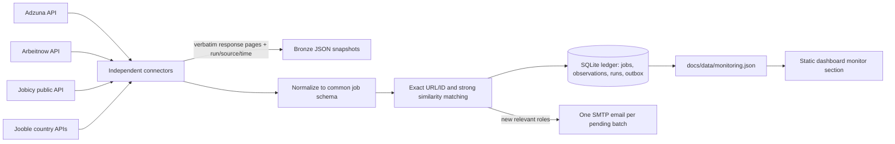

# Multi-source monitor: audit, architecture and operations

## Repository audit (before this change)

- **Architecture:** Databricks notebooks 01–06 use Adzuna, land raw API JSON in a Unity Catalog Volume, ingest append-only Bronze Delta, clean and classify a latest-snapshot Silver table, aggregate Gold tables, and publish static JSON into `docs/data/`. The existing dashboard is a static GitHub Pages site. It reads committed JSON and has no backend.
- **Existing functionality:** Twelve configured Adzuna role searches across DE/AT/CH, up to 45 pages per query, daily filename-based response caching, skill extraction, role classification, historical dashboard datasets, one matcher test module, and a daily Databricks Workflow described in README. There were no checked-in Actions workflow files despite the README test badge.
- **Historical data:** Existing `docs/data/*.json`, Delta notebooks and dashboard visualizations are preserved. No legacy data was rewritten by the monitor.
- **Weaknesses:** Adzuna-only source-specific fields; the legacy cache is keyed by date/query/page and would serve the same response for repeated same-day runs; the Silver flatten notebook overwrites its current snapshot; there is no shared discovery ledger, run lock, notification outbox, or email path; the checked-in repository did not define the described schedule.
- **Changes:** Added a separate Python connector layer, common schema, append-only run/source raw JSON, persistent SQLite discovery and notification state, safe cross-source matching, a Berlin-time service loop, independent source failure handling, health check, dashboard JSON export and a dedicated dashboard view. This avoids changing the legacy Delta tables and schemas.
- **Compatibility:** Existing posting IDs and dashboard records remain untouched. The monitoring section is additive and loads `docs/data/monitoring.json`. The legacy market charts still reflect the historic Adzuna dataset.

## Current source access findings

| Source | Access implemented | Notes |
|---|---|---|
| [Adzuna](https://developer.adzuna.com/docs/search) | Official search API; app ID and key required | Existing integration retained. Search pagination is bounded by `ADZUNA_MAX_PAGES` (default 5) to control request volume; `ADZUNA_ROLES` can replace the default role list. |
| [Arbeitnow](https://documenter.getpostman.com/view/18545278/UVJbJdKh) | Public JSON endpoint, no key | Fetches paginated feed and identifies DE/AT/CH from country names or known DACH cities in the returned location. It does not infer a country from a company name. The dashboard credits the source and links to original feed listings. |
| [Jobicy](https://jobicy.com/jobs-rss-feed) | Public Jobs API, no key | Requests Europe/data-related feed pages and filters to explicit DACH eligibility. The public API links to the Jobicy listing; a direct ATS application URL requires their commercial API and may incur per-job charges, so this code does not request it. The public feed is limited to the latest seven days and has a publication delay; polling is below hourly frequency and requests are spaced at least one second apart. |
| [Jooble](https://jooblehelpcenter.freshdesk.com/en/support/solutions/articles/60001448238-rest-api-documentation) | Country-scoped REST API; separate API key for DE, AT and CH | Searches a combined configurable list of data/AI role terms for each country. Defaults to at most two pages per country per run (up to 10 requests per country on weekdays and 2 on weekend days, below Jooble's documented 100/day free limit). Jooble's `link` is retained as a source listing URL; it is not treated as an employer application URL. Missing keys or a country failure are reported without stopping the other regions or sources. |
| Bundesagentur für Arbeit | Connector stub only | Public material describes a Jobsuche endpoint and shared client ID, but I could not verify a current first-party API contract, stable support, rate limits or terms from authoritative BA documentation. Community copies of an OpenAPI definition disagree on authentication/TLS details. The connector is deliberately disabled; no insecure TLS workaround or undocumented authentication is shipped. |

## Data flow



Bronze stores raw response snapshots. The normalized jobs/observations in SQLite form the monitor's Silver state; the aggregate `docs/data/monitoring.json` is its Gold export. SQLite is durable state for the new monitor: first/last seen, source references, explainable match reasons/scores, run metrics and notification status. Keep the database and Bronze folder on persistent storage, back them up together, and use a single host/filesystem. Do not put the SQLite database on an object store or multi-host network share.

## Unified record, filtering and matching

The monitor emits `job_id`, `source`, `source_job_id`, title, company, country, city, raw location, description, application/source URLs, salary, employment/workplace types, aggregator publication date, first/last observed UTC timestamps, snapshot date, description/record hashes, role category and classification reason. Missing source fields stay null. Original source values remain in `source_metadata` and verbatim Bronze response files. Dashboard timestamps render in Europe/Berlin.

Role keywords search both titles and descriptions. Defaults cover the Data/AI role families in `src/job_monitor/model.py`; `ROLE_KEYWORDS_JSON` may replace them with a JSON object from category names to keyword arrays. Adzuna query terms can be overridden with `ADZUNA_ROLES` and its page limit with `ADZUNA_MAX_PAGES`.

All source records are stored before relevance filtering. Only DACH records with a Data/AI classification enter the notification outbox. Exact matching uses source identity and canonicalized application/source URL. Fuzzy matching requires a different source plus highly similar title and employer, compatible locations and a description similarity threshold; title alone never merges. Records without enough evidence stay separate. Each source reference stores whether grouping used source ID, canonical URL or the title/company/location/description similarity threshold, plus a similarity score. A canonical dashboard item carries all source references and application URLs. Source absence never marks a job closed.

The matching implementation uses Python's standard-library `SequenceMatcher`. Thresholds and rationale are covered by tests. It groups high-confidence matches and intentionally does not create speculative duplicate groups for weak matches.

## Install and run locally

Use Python 3.10+ and install the repository dependencies:

```powershell
python -m venv .venv
.venv\Scripts\Activate.ps1
python -m pip install -r requirements.txt
Copy-Item .env.example .env
```

Fill in Adzuna and SMTP variables in `.env`, then load them in your shell or service manager (the application does not parse `.env` automatically):

```powershell
$env:ADZUNA_APP_ID = "..."
$env:ADZUNA_APP_KEY = "..."
$env:SMTP_HOST = "smtp.example.com"
$env:SMTP_PORT = "587"
$env:SMTP_USERNAME = "..."
$env:SMTP_PASSWORD = "..."
$env:EMAIL_FROM = "alerts@example.com"
$env:EMAIL_TO = "your-address@example.com"
$env:PYTHONPATH = "src"
python -m job_monitor.runner
```

`python -m job_monitor.runner --serve` runs the timezone-aware schedule indefinitely. A service manager should restart the process on failure. `--healthcheck` returns nonzero when there has been no completed run in the last 48 hours. Manual one-off runs use the default command. `--reprocess-bronze` re-normalizes the saved monitor Bronze responses, updates the local normalized view and does not replay historical email. Connector errors are independent; one source can fail while the others complete. All-source failure returns a nonzero exit code and is recorded as failed.

On a new database, use `python -m job_monitor.runner --bootstrap` once to seed the current source listings without sending an initial bulk alert. Then start `--serve`. If you intentionally want to be alerted about every currently returned listing, use a normal manual run instead of bootstrap.

## Collection times and deployment choice

The schedule is expressed in `Europe/Berlin`, not UTC: Monday–Friday at 06:00, 09:00, 12:00, 15:00 and 18:00; Saturday/Sunday at 09:00. Configure alternate comma-separated local hours with `COLLECTION_WEEKDAY_HOURS` and `COLLECTION_WEEKEND_HOURS`. The service checks the local IANA timezone on a 20-second loop and claims each local date/hour slot in SQLite before running. Daylight-saving changes follow Berlin wall time. A filesystem lock and schedule-slot table prevent overlaps and replayed slots. A missed slot is picked up during the first five minutes of that hour; otherwise the next scheduled slot runs. Manual collection remains available and source identity makes retries safe.

GitHub Actions supports timezone-aware scheduled workflows, so `.github/workflows/job-collector.yml` uses `Europe/Berlin` across daylight-saving changes. Scheduled starts can still be delayed during high load, and public-repository schedules can be disabled after 60 days without repository activity. GitHub-hosted jobs run on temporary machines; the workflow keeps the SQLite ledger and Bronze snapshots in a separate private repository, and publishes only `docs/data/monitoring.json` to this repository. Concurrency prevents overlapping scheduled/manual runs. GitHub Actions scheduling is convenient and low maintenance, but does not promise exact-minute starts or that every scheduled run will start.

### GitHub Actions setup

1. Create a **private** repository for persistent state (for example `your-user/dach-job-monitor-state`) and initialize it with a README so it has a default branch. It contains raw API snapshots and notification history; keep it private.
2. Create a fine-grained personal access token scoped only to that private state repository, with **Contents: Read and write** permission. Add it as the `STATE_REPO_TOKEN` Actions secret in this project.
3. Add these secrets in this project: `ADZUNA_APP_ID`, `ADZUNA_APP_KEY`, `JOOBLE_API_KEY_DE`, `JOOBLE_API_KEY_AT`, `JOOBLE_API_KEY_CH`, `SMTP_HOST`, `SMTP_PORT`, `SMTP_USERNAME`, `SMTP_PASSWORD`, `EMAIL_FROM`, and `EMAIL_TO`. Jooble keys are issued from the corresponding regional API portals (`de.jooble.org/api/about`, `at.jooble.org/api/about`, and `ch.jooble.org/api/about`) and are country-specific. The connector uses at most two pages per country per run by default; configure `JOOBLE_MAX_PAGES` if needed while staying within Jooble's documented 100 requests/day/key allowance. The state repository name is set in the workflow file and does not need to be a secret.
4. Ensure the project's Actions settings allow workflows to create and approve commits (repository contents write permission). GitHub Pages, if enabled, should be configured to publish from the branch that receives the dashboard JSON commit.
5. Run **Actions → DACH job collector → Run workflow**. The first run automatically creates a quiet baseline so existing listings do not trigger a bulk email. Confirm the run succeeds, the database and `bronze/` appear in the private state repository, and `docs/data/monitoring.json` updates in the project. Later runs notify you about newly discovered matching jobs.

The collector can also run on demand from the Actions tab. Failed email delivery remains pending in SQLite and is retried on a later successful collection. A source failure does not block other sources; if all sources fail, the workflow fails visibly. The workflow writes no credentials or raw job snapshots to the public project. GitHub schedules may be delayed or dropped during busy periods, and GitHub can disable scheduled workflows in inactive public repositories. Check the Actions tab regularly. Disable the workflow in Actions to stop collection.

For non-GitHub hosting, the collector also supports an example Linux `systemd` unit (adjust paths/user and set secrets through an environment file readable only by the service account):

```ini
[Unit]
Description=DACH multi-source job monitor
After=network-online.target
Wants=network-online.target

[Service]
Type=simple
User=jobmonitor
WorkingDirectory=/opt/DACH-data-job-market
EnvironmentFile=/etc/job-monitor.env
Environment=PYTHONPATH=/opt/DACH-data-job-market/src
ExecStart=/usr/bin/python3 -m job_monitor.runner --serve
Restart=always
RestartSec=10
NoNewPrivileges=true
PrivateTmp=true

[Install]
WantedBy=multi-user.target
```

## Email setup and delivery

Set `SMTP_HOST`, `SMTP_PORT`, optional `SMTP_USERNAME`/`SMTP_PASSWORD`, `EMAIL_FROM` and `EMAIL_TO` as environment variables or managed secrets. Port 465 uses implicit TLS; other ports use STARTTLS. Use an app password where the provider requires one. The email groups pending relevant jobs from a completed collection; no email is sent when the outbox is empty. Failed sends remain pending and are retried on the next run. SMTP cannot guarantee exactly-once delivery if a provider accepts a message and the connection drops before acknowledgement; the persistent outbox prevents normal retries from resending acknowledged mail.

## Dashboard and deployment

The collector writes an additive `docs/data/monitoring.json`. The dashboard reads it when present and gracefully retains the current experience if absent. Filters cover country, title/company, source, role category, workplace, employment type, publication date and first-seen date. The view labels aggregator publication, first discovery and most recent observation separately. Collection summary/freshness are in the export. The collector does not publish or deploy GitHub Pages; keep that release a separately reviewed action.

## Tests

```powershell
$env:PYTHONPATH = "src"
python -m pytest -q
```

Connector, normalization, matching, retry, outbox recovery, locking and Berlin/DST tests use mocked responses and a temporary SQLite database. Tests require neither paid API access nor real email.

## Troubleshooting

- **Adzuna credentials required:** set `ADZUNA_APP_ID` and `ADZUNA_APP_KEY`; secret values are not printed.
- **Email remains pending:** inspect `notification_status` and SMTP host/port/TLS settings, then run collection again. Pending alerts retry.
- **One connector fails:** inspect the run record/logs by source; successful source records remain stored. A source failure is not reported as zero new jobs.
- **Lock already held:** check for another live runner. A stale lock is removed when its PID no longer exists.
- **Health check fails:** restart the supervised service and inspect recent `runs` rows in SQLite.
- **Listing lacks a country:** the connector does not invent DACH eligibility. Broad-Europe/city-only feed entries are omitted until the source establishes a DACH location or eligibility.
- **Dashboard looks stale:** collection writes a local JSON file; use the separate dashboard publishing process to publish it.

## Add another aggregator

Implement a `Connector` subclass in `src/job_monitor/connectors.py`; return a `Result` with independent request counts, raw payload pages and normalized records. Preserve URL semantics, pagination, provider limits and errors. Add mocked tests for success, empty/invalid responses, timeout, rate limit and pagination. Do not enable the Bundesagentur stub until the current official access contract and terms are verified.
